# Git++

> **Git, but plus plus.** A secure, local-first desktop Git client that makes real Git operations understandable without taking control away from experienced developers.

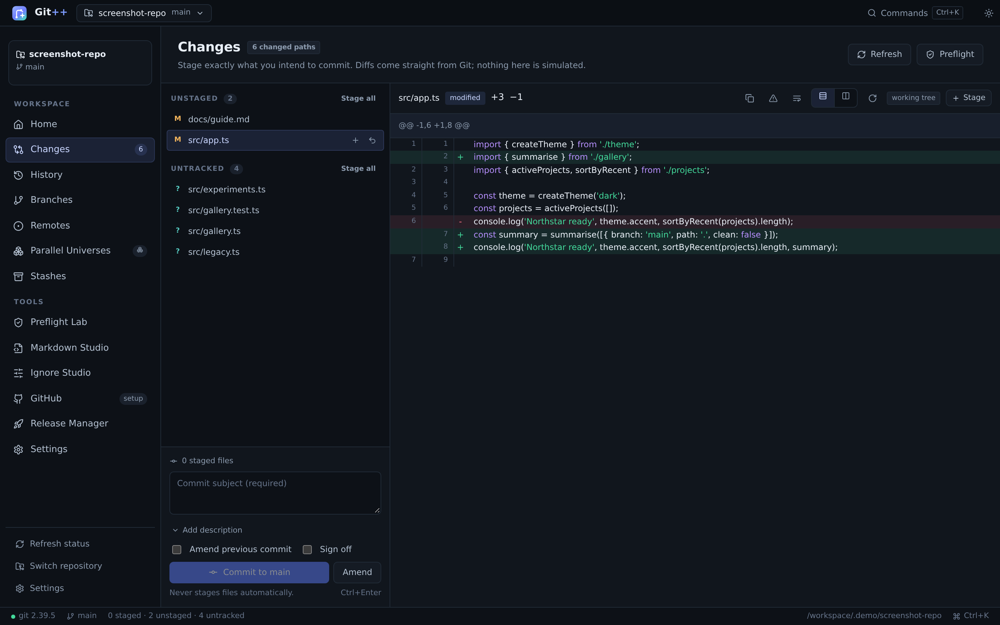

Git++ is an Electron + React + TypeScript desktop application that drives the installed Git executable through a typed, validated backend. It shows genuine status, diffs, history, branches, worktrees, stashes and conflicts — never simulated repository data. On top of that it adds first-class **Preflight Lab** checks, a safe **Markdown Studio**, a `.gitignore` editor, worktree management, release preparation and optional GitHub/AI integrations.

---

## Highlights

### Real Git, real results
- Status from `git status --porcelain=v2` including staged, unstaged, untracked, deleted, renamed and conflicted files.
- Unified and side-by-side diff viewer with hunk navigation, whitespace options, syntax colouring, binary/large-file handling and **per-hunk staging**.
- Commit and amend composer with explicit staging, extended descriptions and preflight policy enforcement.
- Branch creation, switching, rename, safe/forced delete, upstream tracking, ahead/behind and comparisons.
- Merge, rebase, cherry-pick, revert, tags, config editing and a genuine three-way conflict workspace (base / ours / theirs / result), with explicit Mark as resolved, Continue and Abort.
- History graph built from actual parent relationships, commit search, file history (`git log --follow`), historical file versions and reference comparison.
- Fetch, pull (`--ff-only`), push, `--force-with-lease` only behind explicit confirmation, with real Git/network/auth errors.
- Stashes (create/apply/pop/drop) and **Parallel Universes**: real `git worktree` creation, inspection, opening and safe removal.
- Optional GitHub pull requests, issues, releases and workflow runs from the GitHub REST API.
- Optional OpenAI-compatible AI actions for explaining diffs, suggesting commit messages and summarising commits — disabled by default and gated behind explicit consent.

### First-class workspaces
- **Preflight Lab** — repository-aware checks with real commands, timeouts, cancellation, bounded/redacted output, required-check policy, command trust confirmation and stale-result detection.
- **Markdown Studio** — source/preview/split editing, heading outline, find-in-source, external-change detection, save-as-you-mean-it and sanitized preview.
- **Ignore Studio** — edit the real `.gitignore`, browse templates, preview additions, detect duplicates and test paths with `git check-ignore -v`.
- **Release Manager** — notes generated from actual commits since a tag, readiness checklist, tag creation/push and GitHub release publishing behind explicit confirmations.
- **Command palette** and configurable keyboard shortcuts, dark/light themes and persistent settings.

---

## Screenshots

All screenshots below were captured from the running Git++ renderer connected to the real main-process API and a temporary, clearly fictional demo repository (`Northstar Desktop`). No personal repositories or credentials are shown.

| Home (dark) | Changes & diff |
| --- | --- |
| 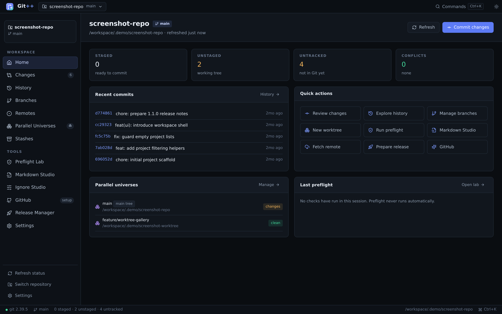 |  |

| History graph | Branches |
| --- | --- |
| 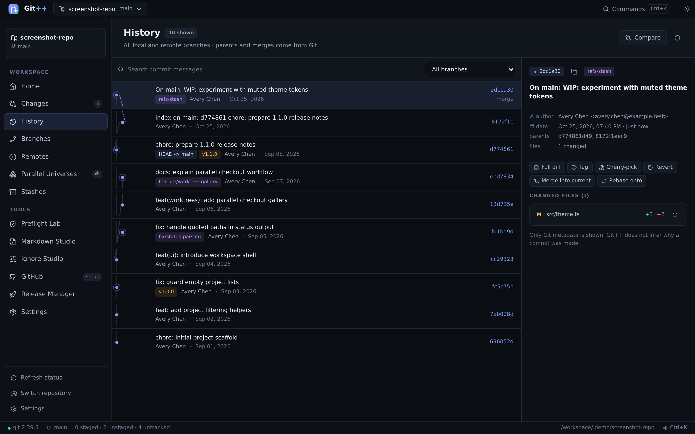 | 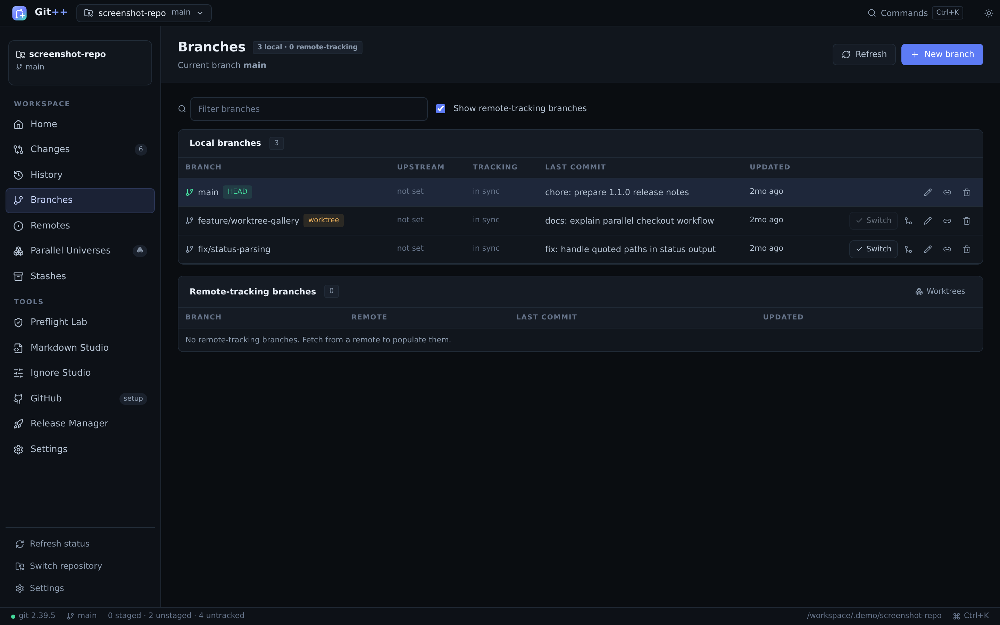 |

| Parallel Universes (worktrees) | Preflight Lab |
| --- | --- |
| 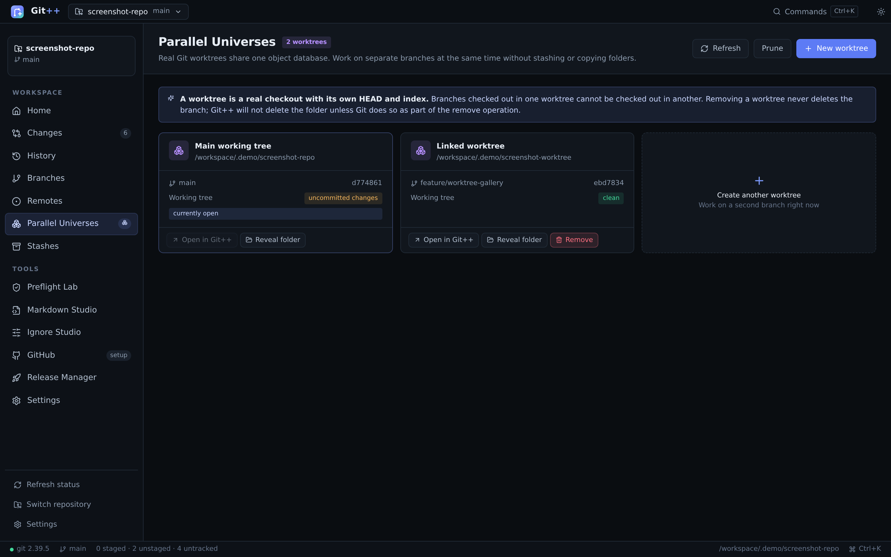 | 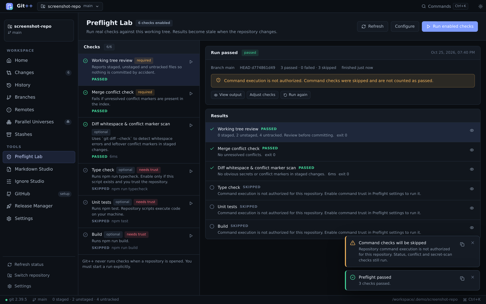 |

| Markdown Studio | Settings |
| --- | --- |
| 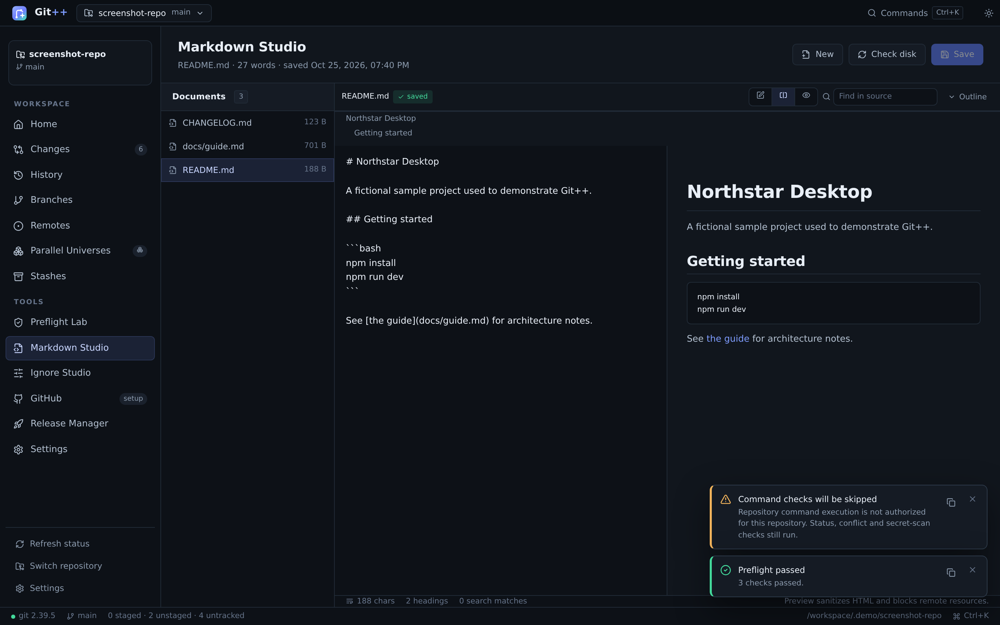 | 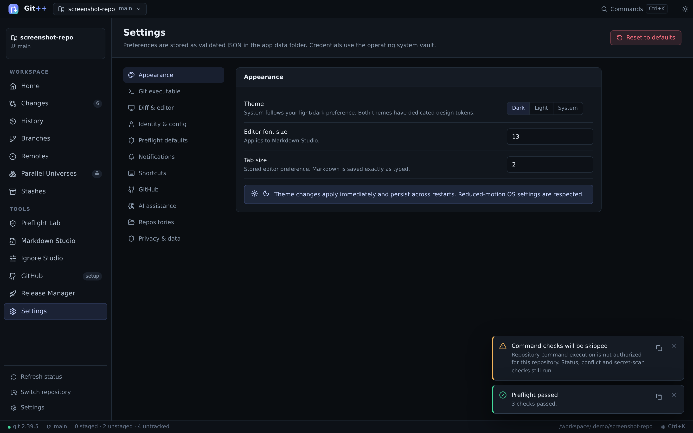 |

| GitHub setup (optional) | Command palette |
| --- | --- |
| 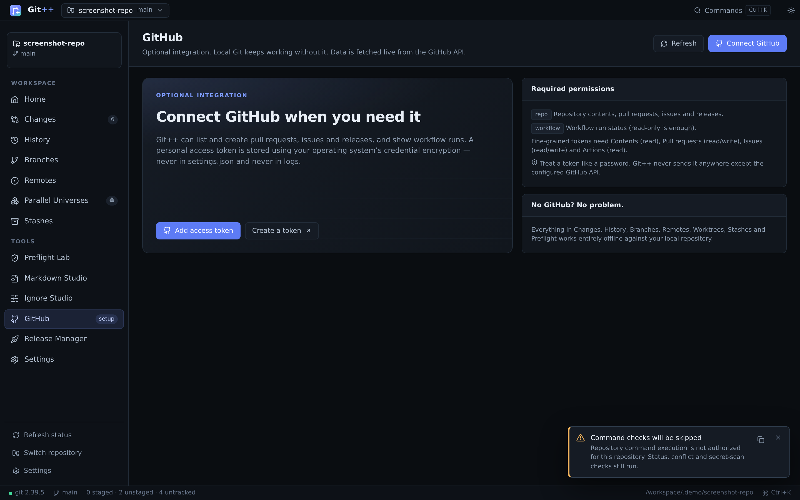 | 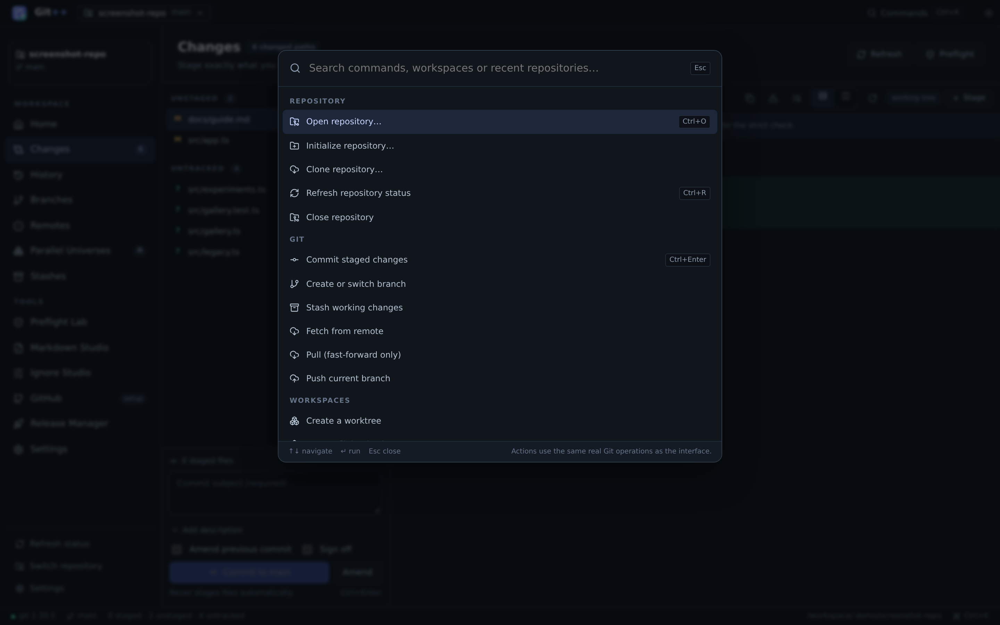 |

| Home (light) | Changes (light) |
| --- | --- |
| 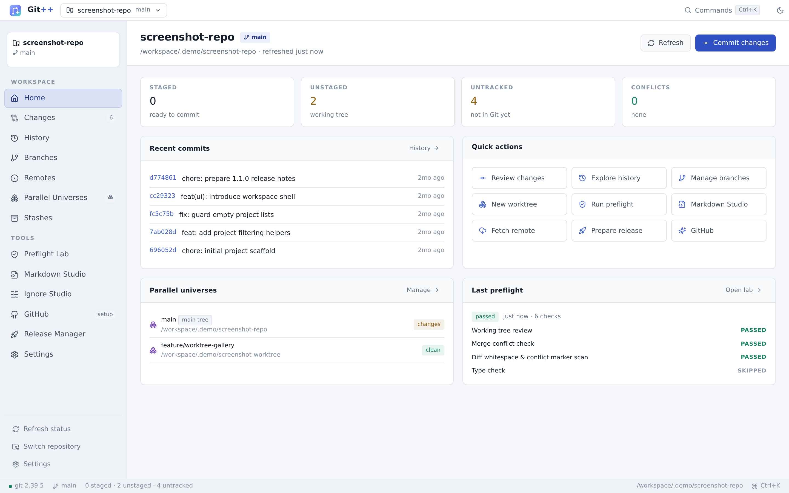 | 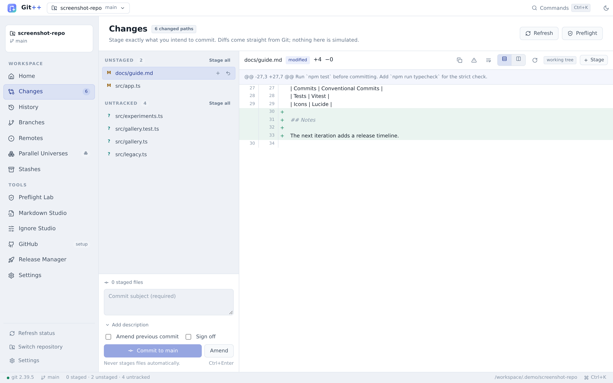 |

More detail: [`docs/screenshots/README.md`](docs/screenshots/README.md).

---

## Platform

- **Primary target:** Windows 10 and Windows 11, x64.
- Development and automated tests in this repository were run on Linux (Debian 12, Node 24, Git 2.39.5). The Electron window itself could not be launched in the headless build environment; see [Known limitations](#known-limitations).
- The renderer and real main-process API were exercised end-to-end in Chromium through a documented test harness, and a Windows unpacked distributable was produced with `electron-builder` where the environment permitted.


---

## Requirements

- Node.js 18+ (development/building)
- npm (the repository scripts use npm; pnpm works too)
- **Git 2.23 or newer** on `PATH` (Git++ uses `git switch`, `git worktree` and `git restore`). Git 2.39.5 was used for testing.
- No paid service, account or cloud dependency for local Git functionality.
- Optional: a GitHub personal access token for the GitHub workspace.
- Optional: an OpenAI-compatible endpoint/key for AI features.

Git++ does **not** bundle Git and does **not** ask for or store your Git password. Authentication is delegated to your normal Git credential helper or SSH agent.

---

## Getting started

```bash
git clone https://github.com/GHisDW/git-plus-plus.git
cd git-plus-plus
npm install

# Development (Vite renderer + Electron main process)
npm run dev

# Production build (renderer + main/preload/harness bundles)
npm run build

# Run the built desktop app
npm start
```

The first launch offers **Open Repository**, **Clone Repository** and **Initialize Repository**. Recent repositories can be pinned; removing an entry from recents never deletes the folder.

### Demo repository (optional)

A disposable, fictional repository used for screenshots and tests can be generated with:

```bash
python3 scripts/create_demo_repo.py
```

It creates `.demo/gitpp-demo` (and a linked worktree). Open it through **Open Repository** or from the recent list. All names, emails and commits in it are fictional.

---

## Testing

```bash
npm run typecheck   # strict TypeScript, including tests
npm test            # Vitest unit + integration tests against temporary real repositories
npm run build       # Vite renderer + esbuild main/preload/harness bundles
npm run test:e2e    # Playwright journeys against the real renderer and API
```

Latest verified results in this environment:

- `npm run typecheck` — **passes** (strict mode).
- `npm test` — **44 tests in 9 files pass**, including real `git init`, staging, hunk staging, commits, branches, merge conflicts, stash, worktrees, cherry-pick/revert, Unicode/space paths, path traversal, preflight runs, settings corruption recovery and IPC contract validation.
- `npm run build` — **passes**; renderer ≈ 494 kB (139 kB gzip), main ≈ 287 kB.
- `npm run test:e2e` — **18/18 checks pass** in the Chromium harness: open repository, genuine status, staging, diff, commit, branch creation/switch, history, preflight, Markdown save, failing-operation error handling, command palette and both themes.

See [`docs/TESTING.md`](docs/TESTING.md) for coverage details and the harness architecture.

---

## Building and packaging

```bash
npm run package       # Windows x64 NSIS installer (needs Windows or Wine on Linux)
npm run package:dir   # Windows x64 unpacked folder
npm run package:win:unpacked:cross  # cross-build unpacked Windows app without rcedit/signing
npm run package:win:zip:cross       # cross-build a Windows x64 ZIP distributable
```

In the Linux build environment used for this delivery:

- `electron-builder --win --x64 --dir -c.win.signAndEditExecutable=false` **succeeded**, producing `release/win-unpacked/Git++.exe` and `resources/app.asar`.
- `electron-builder --win zip --x64 -c.win.signAndEditExecutable=false` **succeeded**, producing `release/GitPlusPlus-1.0.0-x64.zip` (21 MB) as a distributable Windows x64 build.
- The NSIS installer target **did not complete** because `wine` is unavailable. The partial installer was deleted rather than presented as usable.
- No code-signing certificate is configured. A public release should be signed and built on Windows (or a Wine-enabled CI runner) for executable metadata, icon resources and installer signing.


---

## Architecture (short version)

```
Renderer (React, no Node access)
   │  window.gitpp.invoke(method, payload)  – typed via shared contract
   ▼
Preload (contextBridge, narrow API + events)
   ▼  ipcRenderer → ipcMain (sender/frame checked)
Typed API dispatcher (Zod validation for every method)
   ├─ GitService  → GitRunner → child process (arg arrays, timeouts, bounds)
   ├─ SettingsStore / encrypted SecretStore (safeStorage)
   ├─ PreflightService (in-memory runs, real process execution)
   ├─ GithubService (REST, token from OS vault)
   └─ AiService (opt-in, consent-gated)
```

- **No arbitrary command IPC exists.** The renderer can only call the enumerated, validated methods in [`src/shared/contract.ts`](src/shared/contract.ts).
- Git commands are spawned without a shell, with `GIT_TERMINAL_PROMPT=0`, timeouts, bounded output and process-tree termination on cancel/timeout.
- Repository-relative paths are resolved against the repository root, with traversal and symlink-escape checks.
- Settings are schema-validated; corrupted files are backed up and defaults restored.
- Credentials live in OS credential storage (`safeStorage`), never in `settings.json` or logs.

Full details: [`docs/ARCHITECTURE.md`](docs/ARCHITECTURE.md). Security review and residual risks: [`docs/SECURITY.md`](docs/SECURITY.md).

---

## GitHub setup (optional)

1. Create a personal access token at <https://github.com/settings/tokens>.
   - Classic token: `repo` scope (and `workflow` to read Actions runs).
   - Fine-grained token: Contents (read), Pull requests (read/write), Issues (read/write), Actions (read) for the repository.
2. Open **Settings → GitHub**, paste the token and store it. It is encrypted with the operating system credential vault.
3. Open the **GitHub** workspace in a repository whose `origin` points to GitHub.

Git++ keeps local Git fully functional without GitHub. Pull requests, issues, releases and workflow runs are shown only when the API confirms them. GitHub Enterprise is supported by changing the API base URL in Settings. See [`docs/SECURITY.md`](docs/SECURITY.md) for the token-handling model.

---

## AI assistance (optional)

AI is off by default. To use it:

1. Open **Settings → AI**.
2. Configure an OpenAI-compatible base URL (HTTPS, or HTTP for localhost only) and model.
3. Store an API key (OS credential storage).
4. Review and accept the data-sharing notice, then enable AI.

Actions in Changes (explain diff, suggest commit message) and History (summarise commit) send only the diff/commit text you explicitly act on. Suggestions are never applied automatically. Errors from the provider are shown as errors, never as success.

---

## Known limitations

These are deliberately documented rather than hidden:

1. **The Electron window was not launched in this headless environment.** The container lacks GTK/X libraries and there is no desktop session. The renderer and the real main-process API were run end-to-end in Chromium via [`src/main/harness/server.ts`](src/main/harness/server.ts); screenshots come from that actual running UI, not mockups. This harness is not part of the packaged app.
2. **NSIS installer packaging requires Wine on Linux** and did not complete here. A Windows x64 **unpacked** build was produced; installer signing/metadata was not verified. Use Windows or a Wine-enabled CI runner for a release installer.
3. **Submodules** are shown only as far as Git's porcelain status reports them. There is no dedicated submodule management UI.
4. **GitHub pull-request detail** is a summary view sourced from the list endpoint; reviews, inline comments and checks open on GitHub. Genuine create/list operations are implemented.
5. **Preflight run history is in-memory** for the current session. Configuration is persisted per repository; results are not, and runs are marked stale when the repository changes.
6. **AI has no “explain arbitrary error” button yet.** The backend task exists, but the UI surfaces diff/commit AI actions only.
7. **Tag deletion** exists in the backend but not in the Release Manager UI.
8. Large files/diffs are bounded (2 MB file display, 6 MB diff capture, 5000-line untracked preview). Very large patches are truncated with a visible notice.
9. The bundled Chromium/Electron version (Electron 33) should be kept current for security updates before wide distribution.
10. Real Windows-specific behaviours (path casing, credential manager, titlebar, DPI scaling) were implemented but could not be exercised on Windows in this environment.

Additional troubleshooting: [`docs/TROUBLESHOOTING.md`](docs/TROUBLESHOOTING.md).

---

## Security & privacy

- Context isolation on, Node integration off, sandboxed renderer, no webviews, restricted navigation, denied window-open and permission requests, strict CSP.
- IPC sender/frame validation and Zod validation for every method and payload.
- No telemetry. No repository content leaves the machine unless you configure GitHub/AI and explicitly trigger a request.
- Secrets are redacted from errors; tokens/keys are encrypted with OS credential storage and never written to plaintext settings.
- Destructive actions require explicit confirmation, often a typed phrase. Force-push uses `--force-with-lease` and is never the default.
- This is not a certified secure application. See [`docs/SECURITY.md`](docs/SECURITY.md) for the checks performed and remaining risks.

---

## Contributing

- Keep all Git access inside `src/main/git/` and all renderer access behind the typed API contract.
- Add Zod schemas for any new IPC method and a unit/integration test where behaviour is non-trivial.
- Never introduce a generic “run shell command” IPC; Preflight commands are per-repository and consent-gated.
- Run `npm run typecheck`, `npm test`, `npm run build` and (when a browser is available) `npm run test:e2e`.
- Update docs and screenshots when behaviour changes. Do not use fabricated screenshots.

---

## License

MIT. See [`LICENSE`](LICENSE).

Application icon sources: [`build/icon.svg`](build/icon.svg), [`build/icon.png`](build/icon.png). Packaging config: [`electron-builder.yml`](electron-builder.yml).
